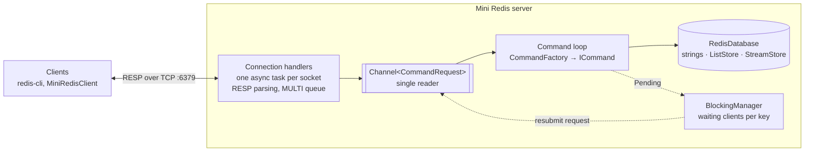
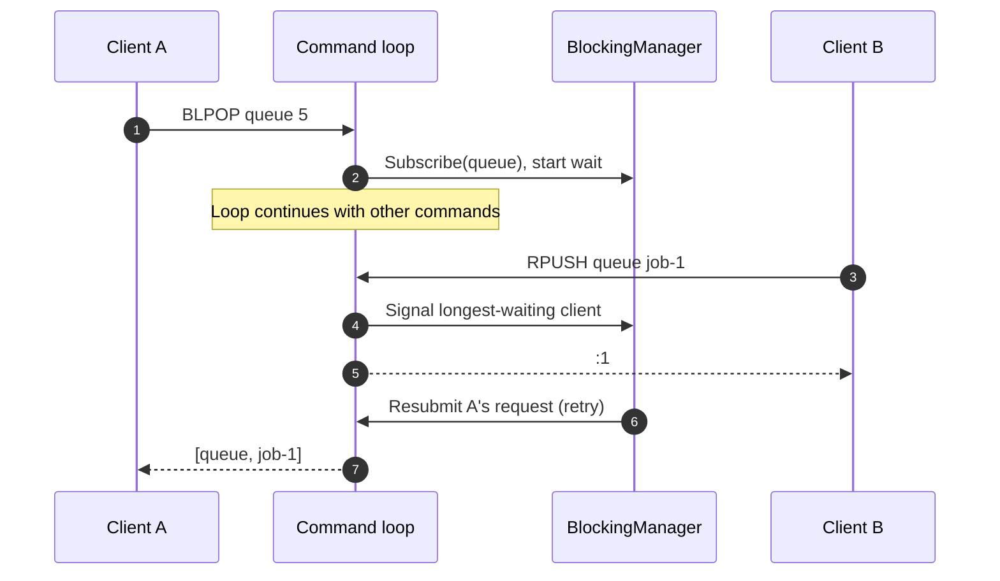

[](https://app.codecrafters.io/users/anht04?r=2qF)

# Mini Redis

A Redis-compatible in-memory server written in C# / .NET 10, built while working through the CodeCrafters ["Build Your Own Redis"](https://codecrafters.io/challenges/redis) challenge. It speaks the RESP protocol over TCP, so `redis-cli` and other Redis clients can talk to it.

> [!NOTE]
> Work in progress. Strings, lists, streams and transactions are implemented; replication, persistence and pub/sub are not yet.

📖 Architecture docs: [DeepWiki](https://deepwiki.com/anht04/mini-redis)

## Supported Commands

| Group | Commands |
|---|---|
| Connection | `PING`, `ECHO` |
| Strings | `SET` (with `EX` / `PX` expiry), `GET`, `INCR`, `TYPE` |
| Lists | `RPUSH`, `LPUSH`, `LRANGE`, `LLEN`, `LPOP`, `BLPOP` (blocking, with timeout) |
| Streams | `XADD` (explicit, partially and fully auto-generated IDs), `XRANGE`, `XREAD` (multiple streams, `BLOCK`, `$`) |
| Transactions | `MULTI`, `EXEC`, `DISCARD` |

## Design

Redis executes commands on a single thread, so no two commands ever race on the same key. Mini Redis keeps that model without locks: each connection handler parses requests and pushes them into one `Channel<CommandRequest>`, and a single consumer loop executes them against the database in order.



- **Request objects.** Each command parses and validates its arguments into a typed request (`SetRequest`, `XReadRequest`, …), so `ICommand` implementations only contain command logic.
- **Per-type stores.** `RedisDatabase` delegates lists and streams to `ListStore` and `StreamStore`. Expired keys are removed lazily when they are read.
- **Outcomes instead of exceptions.** A command returns either `Completed(reply)` or `Pending`; a pending command does not hold up the loop.

### Blocking commands without stalling the loop

`BLPOP` and `XREAD BLOCK` must wait for data, but waiting inside the single command loop would freeze every other client. Instead, a blocking command registers the client with `BlockingManager` and returns `Pending`. The wait happens outside the loop, and the request is put back into the channel when data arrives or the timeout expires. Clients waiting on the same key are woken in FIFO order.



If the timeout expires first, the request is resubmitted as timed out and the client receives a null array.

## Getting Started

**Prerequisites:** .NET 10 SDK.

```bash
# Build and start the server on port 6379
./.codecrafters/compile.sh
./.codecrafters/run.sh

# Or run it directly
dotnet run --project src/Server/MiniRedis.csproj
```

Connect with `redis-cli`:

```bash
redis-cli SET greeting hello PX 5000   # OK
redis-cli RPUSH jobs a b c             # (integer) 3
redis-cli XADD events '*' type signup  # "<ms>-0"
```

The bundled console client (`dotnet run --project src/Client/MiniRedisClient/MiniRedisClient.csproj`) connects to `localhost:6379` and prints raw RESP replies.

## Project Structure

```text
src/
├── Server/
│   ├── Program.cs          # TCP listener, connection handlers, command loop
│   ├── Commands/           # One class per command, typed requests, CommandFactory, BlockingManager
│   ├── Data/               # RedisDatabase, ListStore, StreamStore
│   └── Models/             # Entries, stream IDs, command outcomes
├── Common/                 # RESP formatting helpers, constants, shared result types
└── Client/MiniRedisClient/ # Interactive console client
```

## Known Limitations

- **Data lives in memory only**: there is no persistence (RDB/AOF) or replication.
- **`EXEC` is not atomic.** Queued commands are sent to the command loop one by one, so commands from other clients can run between them.
- **Fixed read buffer.** Each socket read uses a 1 KB buffer and is parsed as one request, so large or pipelined requests are not handled.
